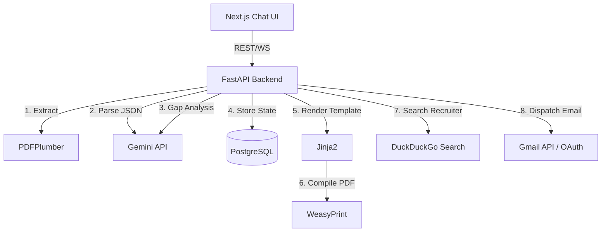

# Architecture Overview

## AutoApply Agent

AutoApply Agent is an AI-powered job application assistant designed to parse a master CV, analyze Job Descriptions, and generate tailored Cover Letters and CV PDFs, before sending them via Gmail.

### 1. High-Level Architecture

The application is structured as a decoupled full-stack application leveraging containerization (Docker).

- **Frontend**: Next.js 14 / React 18, utilizing TailwindCSS for styling.
- **Backend**: Python 3.11 with FastAPI.
- **Database**: PostgreSQL (via Docker) or local SQLite for development.
- **AI Engine**: Google Gemini API for parsing and semantic gap analysis.

### 2. Component Diagram

### 3. Core Modules

- **CV Parser (`parser.py`)**: Uses `pdfplumber` to extract raw text from an uploaded CV and queries the Gemini API to structure the data into a strict "Ground Truth" JSON schema.
- **JD Matcher (`matcher.py`)**: Prompts Gemini with the Ground Truth CV and the Job Description to calculate a match score, find missing skills, and propose tailored bullet points.
- **PDF Generator (`pdf_generator.py`)**: Uses `Jinja2` to map the tailored JSON data into raw HTML templates, which are then compiled into visually consistent PDFs using `WeasyPrint`.
- **Search Agent (`search_agent.py`)**: Executes programmatic DuckDuckGo searches to scrape and filter for the company's HR/Recruiter emails if not explicitly provided.
- **Gmail Service (`gmail_service.py`)**: Connects to the user's Gmail account via OAuth 2.0 to dispatch the generated PDF artifacts as MIME multipart attachments.

### 4. Deployment

The stack is orchestrated using `docker-compose.yml`.
- `db`: PostgreSQL database for tracking application histories and caching the Ground Truth CV.
- `backend`: FastAPI Python container serving the REST API.
- `frontend`: Next.js Node container serving the UI.
